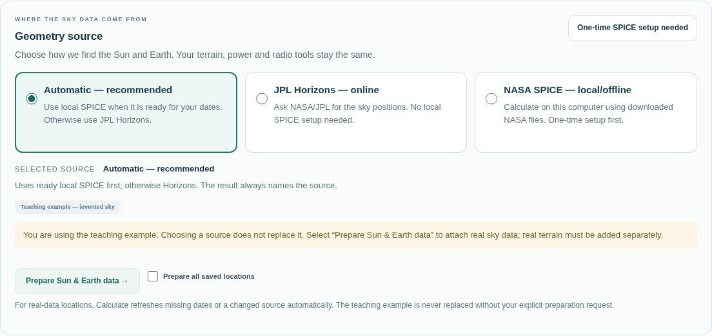
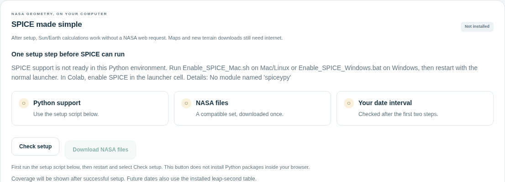
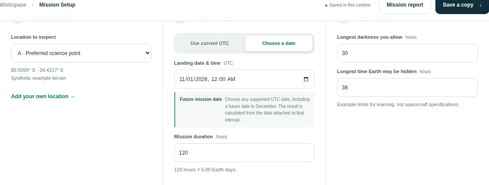
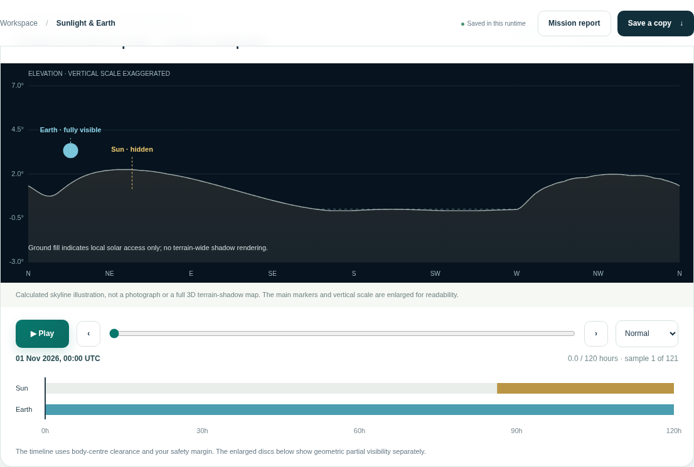
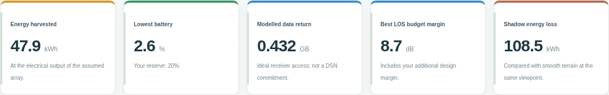
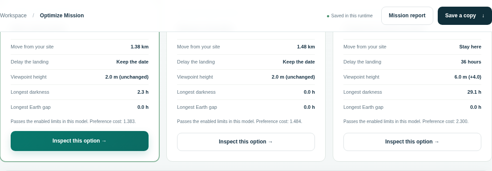

# LunaShift Mission Planner — friendly guide

Version 0.5.0. See the matching PDF for the designed edition.


## 1. Your Moon-planning workspace

LunaShift Mission Planner · Version 0.5.0


Start with one place and one date. The platform checks when the Sun and Earth clear the terrain, then estimates how your panel, battery and radio would perform.





### What changed?


You can now use **Automatic**, **JPL Horizons** or **NASA SPICE** from the normal interface. SPICE is no longer only a separate export script.


### Your first tour


**Mission Setup → Sunlight & Earth → Power & Communications → Compare Options → Optimize Mission.** Use **Data & Sources** to check what the answers are based on.


**Start without pressure.** Keep the opening example and learn the buttons first. Its terrain and sky are invented. The screenshots in this guide use that example; they are not real lunar forecasts.


**Choose your launch page:** Mac: page 2. Windows: page 3. Google Colab: page 4. Geometry choices: page 5. SPICE setup: page 6.


## 2. Open LunaShift on your Mac

First setup installs SPICE. Later starts are shorter.


### 1. Save your old work, then extract the new ZIP


In the old app, click **Save a copy**. Stop its Terminal with **Control + C**. Extract **LunaShift_v5.zip** into Downloads. Keep it separate from earlier versions.


You need **Python 3.10 or newer**. In Terminal, run **python3 --version**. If Python is missing, install it from [the official Python website](https://www.python.org/downloads/).


### 2. Open Terminal and paste these two lines


```text
cd "$HOME/Downloads/LunaShift_v5"
bash Enable_SPICE_Mac.sh
```


The script creates a private Python environment, installs SPICE support, downloads about 19 MB of NASA files and opens the app. The first setup needs internet. Your system Python is not replaced.


### 3. Open the local website


```text
http://127.0.0.1:8765
```


Keep Terminal open while you use the app. Look for **v0.5.0** in the sidebar. If an older screen appears, stop the old server and refresh the browser.


### Next time, use these lines


```text
cd "$HOME/Downloads/LunaShift_v5"
.venv/bin/python run.py
```


**Real terrain files?** From the same folder, run **bash Enable_Real_Data_Mac.sh** once to add the optional GeoTIFF tools. SPICE itself does not read terrain.


To stop: **Control + C** in Terminal. To restore your previous project: **Data & Sources → Open a saved workspace**.


## 3. Open LunaShift on Windows

Use the launcher files. You do not need to edit Python code.


### 1. Check Python and extract the ZIP


Install **Python 3.10 or newer** from [python.org](https://www.python.org/downloads/). Enable the installer’s **Add Python to PATH** option. Right-click **LunaShift_v5.zip → Extract All**. Do not run from the ZIP preview.


### 2. First time: enable SPICE


```text
Enable_SPICE_Windows.bat
```


Double-click that file inside the extracted folder. It creates a private environment, installs the Python support, downloads the matching NASA files and starts the platform. Keep the window open.


### 3. Open the app in your browser


```text
http://127.0.0.1:8765
```


If the NASA files cannot be downloaded, the app can still open. Read the message in **Data & Sources → SPICE made simple** rather than assuming SPICE is ready.


### For later sessions


```text
Start_Windows.bat
```


Double-click this normal launcher. It uses the private SPICE environment when one exists. Press **Control + C** in the command window to stop.


### Optional: add real-terrain file support


Open PowerShell in the extracted app folder and run:


```text
.\.venv\Scripts\python.exe -m pip install -r requirements-terrain.txt
```


**Then restart** with **Start_Windows.bat**. Only terrain import needs these extra packages.


Before upgrading again, click **Save a copy**. Move your exported JSON, not the old virtual-environment folder.


## 4. Use only your browser

Useful on Mac or Windows when you do not want a local installation.


### 1. Upload the notebook


Open [Google Colab](https://colab.research.google.com/). Select **File → Upload notebook** and choose **LunaShift_v5_Colab.ipynb**.


### 2. Run “Upload and launch”


Press the play button beside the first code cell. When asked, upload **LunaShift_v5.zip**. Keep it as a ZIP; do not upload the extracted folder.


### 3. Leave these settings on


```text
INSTALL_SPICE = True
DOWNLOAD_SPICE_KERNELS = True
INSTALL_REAL_DATA = True
```


The cell installs the tools and opens LunaShift below it. Use a **CPU runtime**; this release does not use CUDA. The first setup needs internet.


### 4. Work inside the embedded app


Select your geometry source in **Mission Setup**. In Colab, “local SPICE” means local to Google’s running computer, not installed on your Mac. You do not enter a Mac Downloads path.


### 5. Save before disconnecting


Run **Download my workspace** in the notebook. Keep the JSON file. In your next session, start the app again and open that saved workspace.


**Colab is temporary.** If the runtime is deleted, installed packages and NASA files must be set up again. A saved notebook alone does not save the app’s workspace.


If the display disappears, run **Diagnostics / display the app again**. The notebook also includes an optional actual-SPICE check and source-connection report.


## 5. Where do the sky positions come from?

“Geometry” simply means where the Sun and Earth are from your location.


### Automatic — recommended


When a new track is needed, use local SPICE if its files and your dates are ready. Otherwise ask JPL Horizons. The result records which source was used and why.


### JPL Horizons — online


Use this when you prefer an online request. It does not require local kernels. If the request fails, the app tells you; it does not quietly switch to SPICE.


### NASA SPICE — local/offline


Use this after SPICE setup. The sky positions are calculated locally. If files or date coverage are missing, you get a setup message—not an invented or silently substituted answer.


**Choosing is not preparing.** After choosing a source, press **Prepare Sun & Earth data**. The teaching example stays unchanged until you explicitly do this. Existing external CSV can remain in use under Automatic; prepare again to replace it.


## 6. Make SPICE ready once

Open Data & Sources → SPICE made simple.





### Read the three checks


**Python support:** the current app environment can import SpiceyPy. **NASA files:** the compatible files are present. **Your date interval:** the files cover your requested mission.


### What should I click?


Run the setup script from page 2 or 3 first. Then click **Check setup**. If Python support is ready but files are missing, click **Download NASA files**. Return to Mission Setup and select **Prepare Sun & Earth data**.


You do not need to pick technical kernel filenames. This release manages one matched **DE421 / MOON_ME_DE421** set. It is chosen for compatibility, not advertised as the newest ephemeris. The app checks coverage from the loaded files.


### Optional: compare the two engines


Expand **Compare SPICE with Horizons** and run the comparison. It checks the first 24 mission hours and leaves your attached data unchanged. Differences are a diagnostic, not a flight-accuracy certificate.


**Offline means sky calculations.** New map imagery or terrain downloads may still need internet. Real-kernel execution could not be verified in the build environment; use the local setup check and comparison on your computer.


## 7. Choose a location you can investigate

Lunar Map chooses the place. Data & Sources prepares the information.


### Lunar Map: pick and save


Connect to the NASA map. Pan, zoom and click a point, or enter latitude and east longitude. Give the point a name and click **Save candidate**. A saved marker is not a claim that the land is safe.


**If the map service is unavailable:** use coordinates or an existing saved site. The app reports the connection problem. A coarse image fallback is visual context, not terrain for calculations.


### A real analysis needs two different things


**1. Ground data.** Attach a compatible LOLA/PGDA elevation file or a terrain-skyline CSV for the selected point. Check the frame, height units, coverage and resolution. The optional terrain tools read GeoTIFF files.


**2. Sky data.** Choose Horizons or SPICE, choose the date, then prepare the Sun/Earth tracks. Preparing real sky data does **not** replace invented terrain.


### An easier first real-data exercise


In Data & Sources, use **Load a real NASA example** after optional terrain support is installed. It attempts a real elevation download and prepares the sky with your selected source. It commits the workspace only when the complete operation succeeds.


That example uses a raster-centre candidate and a limited terrain area. It is not an approved landing point. Confirm the source labels before reading the results.


### Useful official links


[Moon Trek: explore imagery](https://trek.nasa.gov/moon/)
[PGDA: elevation and slope data](https://pgda.gsfc.nasa.gov/products/78)
[Horizons: online sky calculations](https://ssd-api.jpl.nasa.gov/doc/horizons.html)


For CSV files, the app shows the required columns. Use **docs/DATA_FORMATS.md** for exact formats. A filename alone never proves that a dataset matches your site.


## 8. Now, December, or another date

Mission Setup controls the location, time, duration and limits.





### To try a future mission


Choose **December 15, 2026, 00:00 UTC** and a duration of **168 hours**. That mission ends on **December 22, 2026, 00:00 UTC**. Select the source, prepare the sky data, then click **Check my plan**.


### To use the current time


Click **Use current UTC**. This inserts the current time once. It is not a continuously connected Moon camera or live spacecraft telemetry. Recalculate after changing the date.


### Set limits you understand


Start with the longest darkness you allow and the longest gap without Earth visibility. The example limits are only teaching values. Under **More settings**, adjust viewpoint height, slope limit, safety margin and time spacing.


**Watch the data coverage.** A future date is valid only when the sky data cover the full interval. For a real site, missing dates or a changed explicit source are prepared during calculation. The teaching example is not silently replaced.


A shorter calculation step shows more timing detail but takes more work. Preparing all saved locations is helpful before comparing them.


## 9. Watch the view change with time

This page explains why the lander has light—or loses its view of Earth.





Click **Calculate visibility**, then **Play**. Pause, drag the slider or use the previous/next buttons. The timestamp, Sun, Earth and timelines use the same mission clock.


Choose **Whole horizon**, **Follow Sun** or **Follow Earth**. The enlarged discs show fully visible, partly visible or hidden. The timeline uses body-centre clearance plus your chosen safety margin; these are related but not identical displays.


**Two different shadow views:** the local skyline uses attached terrain. The map’s day/night overlay uses a smooth lunar sphere, not every crater’s shadow. NASA Eyes and the reference animation are separate viewers with their own time controls.


## 10. Turn visibility into a lander estimate

Start with three simple numbers. Open advanced settings only when needed.





### 1. Choose your hardware


Enter **solar-panel area**, **battery capacity** and **desired returned data**. Presets are illustrative, not official spacecraft specifications. Expand settings to adjust orientation, efficiencies, power demand and radio assumptions.


### 2. Click “Check power & communications”


Read the top result first. Then look at harvested energy, the lowest battery level, the radio margin and the amount of data returned. The charts share one time cursor.


### 3. Understand what is limiting the mission


Sunlight does not automatically mean enough electrical power. The panel angle, area and losses matter. A radio budget can be positive while terrain blocks Earth. Data return also needs energy and stored data to transmit.


### 4. Try a small change


Increase panel area or battery capacity and run again. Under **Find tested repairs**, try saved locations, selected panel/battery multipliers and optional 12/24-hour delays.


**These are engineering estimates.** The radio model is Earth-centre line-of-sight with a generic receiver, not a booked DSN station. Detailed thermal dynamics, measured fading and flight qualification are not included.


## 11. Find a better option—and see why

Change one thing at a time so the result is easy to understand.





### Compare Options


Keep the same date, duration and limits. Compare your saved sites by sunlight, longest darkness, Earth visibility and the stated failure reason. For the same hardware at different sites, use the table on Power & Communications.


### Optimize Mission


Choose what may change: saved location, landing delay or viewpoint height. Click **Find better options**. Read the change and result on each card. Use **Inspect** to view an alternative; you can restore the original plan.


### Hardware repairs are on the power page


Use its repair button for larger panels or batteries. These tests must satisfy the visibility checks and the hardware checks. They are separate from the location/time/height search.


**“Best” means best among the tested options.** This is not a global search of the whole Moon and not a guaranteed minimum-cost spacecraft design. Missing data stay unknown; extra delays require extra sky-data coverage.


## 12. Keep your work—and know its limits

Save a copy before upgrades, long experiments or closing Colab.


### Save and reopen


Click **Save a copy** to download workspace JSON. Open it later from **Data & Sources → Open a saved workspace**. It keeps the numerical data, actual geometry source and settings. It does not include installed packages, kernel binaries or your original large raster files.


### Share with your group


Send the app ZIP and the exported JSON. Each teammate starts their own app. **127.0.0.1** opens only on the computer running the server; it is not a public website. Use **Help & Guide** for the tour and this PDF.


### When something does not work


**“SPICE not installed”:** run the setup script, then restart with the private environment.
**“NASA files missing”:** check internet, then retry Download NASA files.
**“Dates not covered”:** choose a supported interval or explicitly select Horizons.
**No moving sky:** calculate first; check the site has terrain and tracks.
**Old screen:** stop the older server and refresh. Confirm v0.5.0.


**What was tested:** 203 Python tests and 200 scripted interface checks. Actual SPICE-kernel execution, live NASA downloads, native Mac/Windows launch and signed-in Colab were not verified in the build environment. Use the in-app checks on your computer. This is decision support, not flight certification.


**Technical details when you need them:** docs/SPICE.md, docs/DATA_FORMATS.md and docs/TEST_REPORT.md. Run tools/verify_spice.py with your SPICE-enabled Python for an actual-kernel check.


**Official references:** [NASA kernels](https://naif.jpl.nasa.gov/naif/data_generic.html) · [Matching lunar frame](https://naif.jpl.nasa.gov/pub/naif/generic_kernels/fk/satellites/moon_080317.tf) · [CSPICE geometry](https://naif.jpl.nasa.gov/pub/naif/toolkit_docs/C/cspice/spkcpo_c.html) · [SpiceyPy installation](https://spiceypy.readthedocs.io/en/stable/installation.html)
